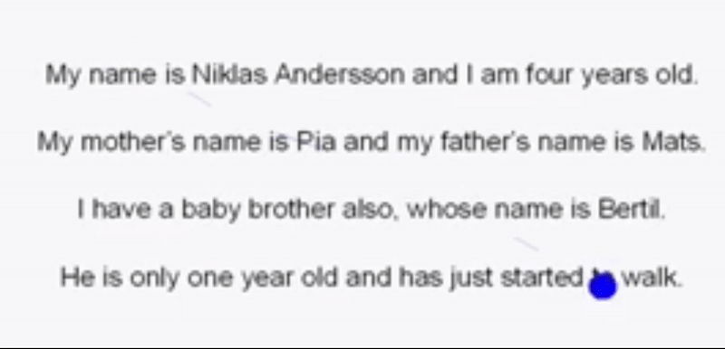
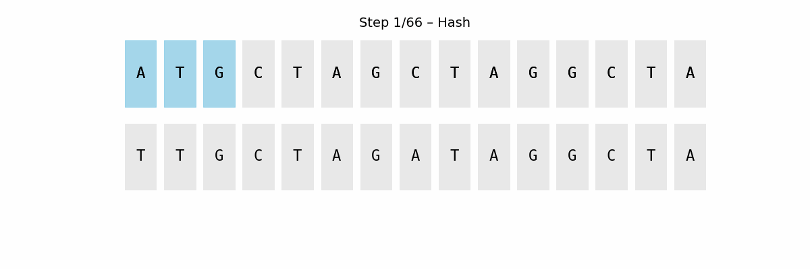
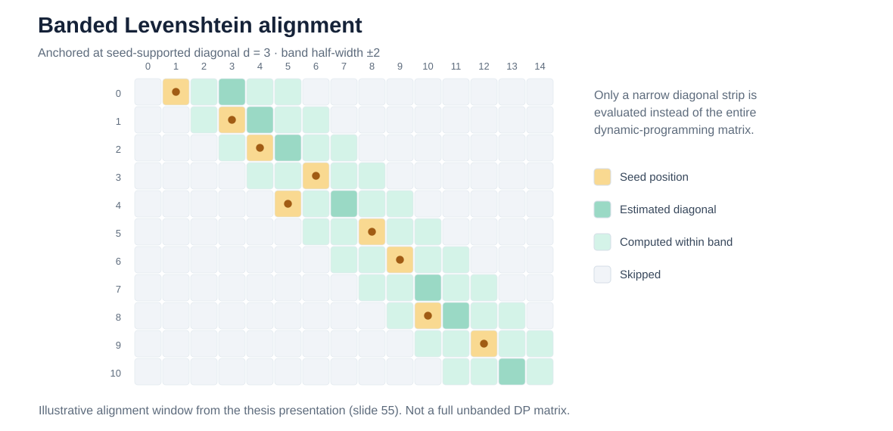
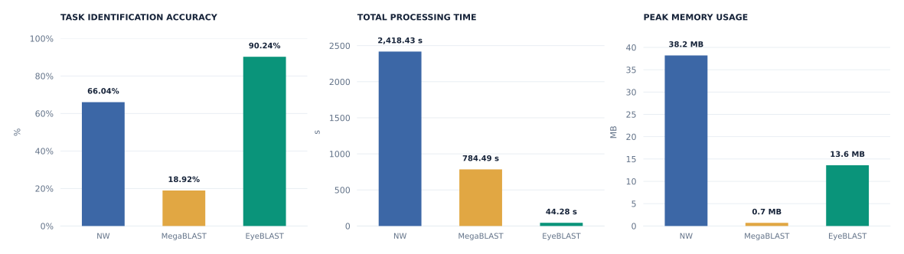
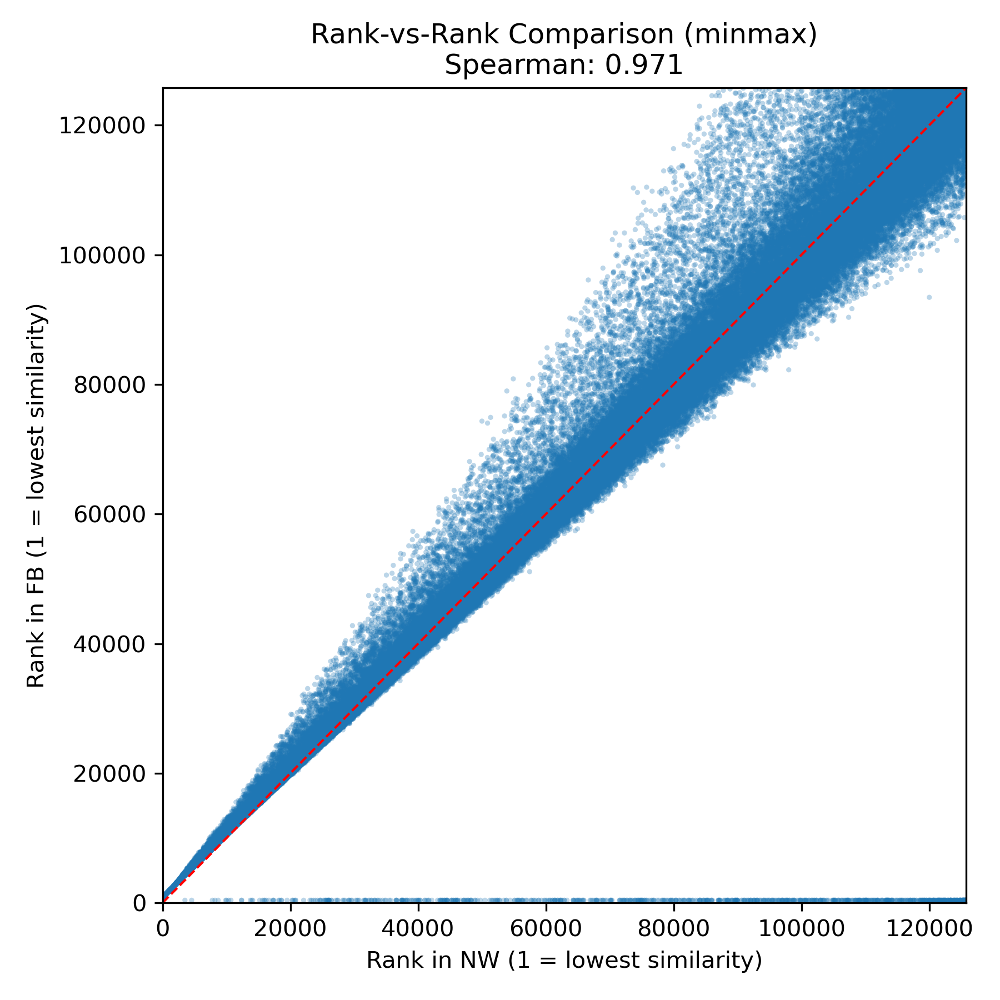
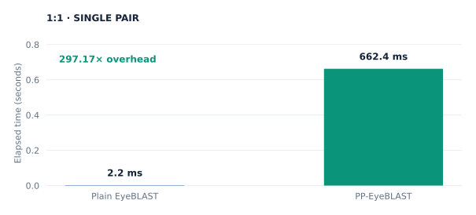
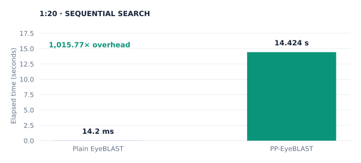

<div align="center">

# EyeBLAST

### Fast scanpath alignment · privacy-preserving eye-tracking analysis

**compare eye-tracking data in a FAST, PRIVATE, and SECURE way**

[](https://www.python.org/)
[](https://isocpp.org/)
[](#research-and-citation)
[](LICENSE)


</div>

---

## At a glance

| **90.24%** | **44.28 s** | **≈ 54.6×** | **ρ = 0.971** | **662.4 ms** |
|:--:|:--:|:--:|:--:|:--:|
| Task identification accuracy | Total processing time | Faster than Needleman–Wunsch | Spearman rank correlation with NW | Private 1:1 comparison |

<sub>Results from the specified GazeBaseVR experiments. See [Evaluation](#evaluation) and [Limitations](#limitations-and-security-model).</sub>

### Why?

Eye movements carry more information than a pointer on a screen. They encode patterns of visual attention and behaviour, and their analysis can be informative but exposing raw gaze traces to every system that compares them is often unnecessary.

Traditional alignment methods such as **Needleman–Wunsch** and **Levenshtein distance** calculate dynamic-programming scores over an entire pair of sequences, with an \(O(nm)\) alignment cost. 

**EyeBLAST** tries a different approach. Finding the right neighbours before doing the expensive alignment and then comparing them without disclosing the original gaze data.

**EyeBLAST** is a fast, filter-first similarity pipeline. **PP-EyeBLAST** is its experimental privacy-preserving implementation using **two-party garbled circuits**.

> Across representative configurations, the project demonstrates **roughly 30–50× faster plaintext comparisons than conventional alignment baselines**, **comparable or better task-identification performance**, and approximately **2–5 ms for an individual plaintext comparison** in the reported measurements. 

## Eye-tracking in 30 seconds



- **Fixations**: relatively stable periods when gaze remains on an area of interest, typically on the order of tens to hundreds of milliseconds.
- **Saccades**: rapid movements that shift gaze between fixations.
- **Microsaccades**: small, involuntary saccadic movements, often occurring during fixation.
- **Scanpaths**: the **time-ordered sequence** of these eye-movement events; EyeBLAST represents events as symbols with duration information.

In the animation, pauses correspond to fixations, jumps to saccades, and fine movements around a point illustrate microsaccades. A scanpath preserves the ordering of these events.

## The idea: borrow the search philosophy of BLAST



The **NCBI Basic Local Alignment Search Tool (BLAST)** searches biological sequence databases efficiently by looking for promising short matches (*seeds*) before extending them into longer alignments. **MegaBLAST**, a nucleotide-oriented BLAST variant, was an early inspiration for this work.

Instead of comparing every position with every other position immediately:

1. **Find short matches.** Candidate locations share a small seed or subsequence.
2. **Extend around promising matches.** Adjacent matches support longer alignments.
3. **Refine the candidates.** Spend dynamic-programming effort where there is evidence of a match.

EyeBLAST borrows this **seed-and-extend philosophy**. It adapts the idea to symbolic gaze sequences and adds compact encoding, SimHash/LSH candidate retrieval, and banded edit-distance scoring. 

## How EyeBLAST works

```text
Raw gaze samples  (x, y, time)
         │
         ▼
  1. PREPROCESSING     I-VT → duration bins → token IDs → packed words
         │
         ▼
  2. ROUGH FILTERING   64-bit SimHash → multi-table LSH → Hamming ranking
         │
         ▼
  3. FINE ALIGNMENT    extract seeds → select chain/diagonal → banded Levenshtein
         │
         ▼
  Similarity scores → nearest-neighbour retrieval / k-NN task classification
```

### 1 · Preprocessing: make gaze sequences computationally manageable

The input begins as timestamped coordinates. **Velocity-Threshold Identification (I-VT)** segments them into fixation (`F`), saccade (`S`), and microsaccade (`M`) events. The pipeline then applies **logarithmic duration binning**, maps the resulting symbols to integer IDs, and **packs IDs into 64-bit machine words**.

```text
Raw events:      F180   S90   F300   M30   F100
Binned symbols:   F7    S6     F8    M4     F6
Integer IDs:       0     1      4     5      3
Packed words:    [      compact binary word sequence      ]
```

The illustrative IDs depend on the vocabulary mapping; the goal is to replace verbose event strings with compact representations that support inexpensive bitwise operations.

### 2 · Rough filtering: search before aligning

Each packed scanpath is summarised with a **64-bit SimHash fingerprint**. The sketch is partitioned into slices and inserted into **multiple locality-sensitive hash (LSH) tables**. A query probes matching buckets to retrieve likely neighbours, rather than aligning against the entire dataset.

Surviving candidates are ranked using the exact **Hamming distance between their sketches**:

```text
Hamming distance = popcount(query_sketch XOR candidate_sketch)
```

The default documented configuration uses **eight 8-bit slices** and forwards up to **20 promising candidates** for refinement. SimHash and LSH are probabilistic *candidate-selection mechanisms*; their sketch distances are not substitutes for the final scanpath similarity score.

### 3 · Fine alignment: compute only where it matters

For each surviving candidate, EyeBLAST extracts matching **packed-word seeds**, estimates a seed-supported alignment **diagonal**, and evaluates **banded Levenshtein distance** around that path rather than computing every cell of a full dynamic-programming matrix.



With a fixed-width band, the refinement visits approximately **\(O(W\,\max(n,m))\)** cells rather than **\(O(nm)\)**. This does **not** mean the method always returns the same score as full dynamic programming: equivalence holds when the optimal alignment path remains within the chosen band, and candidate pruning can also affect which matches are considered.

The final normalised similarity scores can feed a **k-nearest-neighbour (k-NN)** classifier, as in the task-identification evaluation below.

## Evaluation

### Plain EyeBLAST · GazeBaseVR



| Algorithm | Top-1 accuracy | Total time | Memory |
|:--|--:|--:|--:|
| Needleman–Wunsch | 66.04% | 2,418.43 s | 38.2 MB |
| NCBI MegaBLAST | 18.92% | 784.49 s | 0.7 MB |
| **EyeBLAST** | **90.24%** | **44.28 s** | **13.6 MB** |


In this experiment, EyeBLAST required **about 55× less total processing time** than Needleman–Wunsch while producing higher task-identification accuracy. The poor MegaBLAST score here reflects the tested adaptation and configuration. This is not a general assessment of BLAST for its intended biological domain.

### Does it preserve Needleman–Wunsch's ordering?

<div align="center">



</div>

**Spearman's ρ = 0.9706 (≈ 0.971)** for the GazeBaseVR pairwise similarity study, indicating **strong agreement in rank order**. This matters for nearest-neighbour search: two scoring systems can use different numerical scales yet produce similar rankings.

This statistic does **not** imply the numerical scores are identical: Pearson's *r* was **0.4796** in the same analysis. The plotted rank figure is the original high-resolution research figure, not a synthetic reconstruction of unavailable point data.

## PP-EyeBLAST: privacy-preserving comparison

A quick search is useful. A quick search that avoids handing over raw scanpaths is better.

**PP-EyeBLAST** transfers the core comparison to **two-party garbled circuits (GC)**. Both parties locally preprocess their scanpaths, then participate in secure computation over a coarse similarity gate and the fine-alignment stage. The implementation targets the **semi-honest** threat model, with deliberately restricted output disclosure.

- **1:1:** Alice provides one query and Bob one reference. A garbled-circuit rough filter checks their sketches, then the protocol refines passing pairs with seed chaining and banded alignment. The designated result recipient obtains the similarity score (with coarse pass/fail leakage), rather than the other's raw sequence.
- **1:N:** Alice compares a query against Bob's collection. The current prototype performs **repeated secure coarse comparisons**, collects passing candidates, and applies secure refinement / k-NN logic. The 1:N prototype **does not implement the plaintext LSH-index lookup privately**.

### 1:N protocol: complete diagram


### Secure-comparison timings





| Setting | Plain | PP-EyeBLAST | Overhead |
|:--|--:|--:|--:|
| 1:1 comparison | 0.0022 s | **0.6624 s** | 297.17× |
| 1:20 sequential comparisons | 0.0142 s total | **14.4240 s total** | 1,015.77× |


Subsecond **single-pair** private comparison is feasible in this prototype. Multi-target secure search is substantially slower and currently scales approximately linearly with the number of targets because private indexed pruning is absent.

## Repository structure

```text
EyeBLAST/
├── EyeBLAST/
│   ├── EyeBLASTv7_SimHash-LSH_vs_Chaining-Banded/
│   │   ├── Fast_EyeBLAST_IVT.py        # Plain algorithm / comparison implementation
│   │   ├── GazeBaseVR_IVT.py           # Gaze preprocessing / tokenisation
│   │   ├── comparison_study.py         # Benchmark driver
│   │   └── DEMO.ipynb                  # Interactive research notebook
│   ├── NW_EYEBLAST/                    # Baselines and additional comparisons
│   └── EyeBLASTv6_FASTA/              # Preliminary FASTA adaptation
├── PP_EyeBLAST/
│   ├── src/                             # C++ plaintext and GC implementation
│   ├── include/                         # C++ headers
│   ├── tests/                           # Equivalence and toolkit tests
│   ├── benchmark_plain_vs_pp.py         # Timing driver
│   └── CMakeLists.txt
├── assets/                               # Figures and original animated demonstrations
├── LICENSE
└── README.md
```

This repository includes exploratory research versions and dataset-specific scripts, rather than a packaged Python library or a one-command production installer.

## Getting started

**Plaintext research implementation** (Python 3.11; typical dependencies include NumPy, Pandas and plotting/scientific packages):

```bash
git clone https://github.com/aynader/EyeBLAST.git
cd EyeBLAST
python -m venv .venv
source .venv/bin/activate  # Windows: .venv\Scripts\activate
pip install numpy pandas matplotlib scipy scikit-learn numba seaborn tqdm joblib psutil
```

With the **separately obtained** GazeBaseVR CSV files, tokenise a sample and then run the plaintext EyeBLAST-only comparison (the options below are verified against the repository scripts):

```bash
python EyeBLAST/EyeBLASTv7_SimHash-LSH_vs_Chaining-Banded/GazeBaseVR_IVT.py \
  --input_dir /path/to/GazeBaseVR/data --output_dir ./GazeBaseVR_IVT

python EyeBLAST/EyeBLASTv7_SimHash-LSH_vs_Chaining-Banded/comparison_study.py \
  --input_dir ./GazeBaseVR_IVT --comparison fb-only \
  --seed_length 3 --band_width 5 --max_candidates 20 --k 7
```

For an initial smoke test, append `--test` **only to the preprocessing command**; this writes just one token file and is not enough for a meaningful k-NN evaluation. The full benchmark requires enough recordings and labels for a train/test split. The `DEMO.ipynb` notebook is also available in the same directory. External datasets and dependencies, including NCBI BLAST binaries for *MegaBLAST* comparison modes, must be supplied separately.

**Privacy-preserving research prototype** requires Linux/WSL, C++17, CMake, OpenSSL, and [EMP-toolkit](https://github.com/emp-toolkit) components (`emp-tool` and `emp-sh2pc`). The current `PP_EyeBLAST/CMakeLists.txt` expects a local `third_party/emp-sh2pc` checkout in addition to installed dependencies. **Do not expect an immediate out-of-the-box build without provisioning them**. Relevant entry points are `PP_EyeBLAST/src/pp_main.cpp`, `PP_EyeBLAST/tests/test_equivalence.cpp`, and `PP_EyeBLAST/benchmark_plain_vs_pp.py`.

## Limitations and security model

- **Research software:** The threat model is **semi-honest** and it does not claim malicious-adversary security, side-channel resistance, or a clinical/biometric certification.
- **Privacy is not the same as anonymity.** I-VT tokenisation and packed representations do not by themselves guarantee that a person's behavioural characteristics cannot be inferred. Secure computation is intended to limit data revealed *during comparison*.
- **Selective alignment.** LSH pruning and banded refinement improve speed but can miss candidates or optimal paths and results are parameter and dataset-dependent.
- **1:N cost.** The GC prototype does not privately reproduce plaintext LSH-table pruning and the measured secure multi-target cost grows approximately linearly with collection size.

## Research and citation


**Related peer-reviewed publication:** Süleyman Özdel, Amr Nader, Yasmeen Abdrabou and Enkelejda Kasneci. “**Secure Storage and Privacy-Preserving Scanpath Comparison via Garbled Circuits in Eye Tracking**.” *Proceedings of the ACM on Human-Computer Interaction*, 10(3), ETRA008 (May 2026). **[DOI: 10.1145/3806022](https://doi.org/10.1145/3806022)**.


## License

MIT License. see [LICENSE](LICENSE). The MIT grant applies to original project code and documentation for which the copyright holder has authority to license. Third-party frameworks, vendored code, datasets, fonts, and externally created illustrations retain their own licenses and attribution requirements. Check any pre-existing institutional or contributor obligations before applying a repository-wide license.

---

<div align="center">

**EyeBLAST** · Filter first. Align precisely. Reveal less.

</div>
